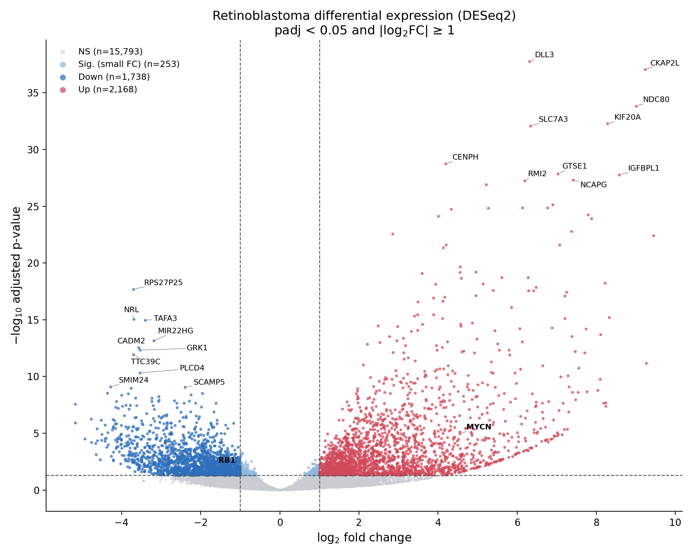
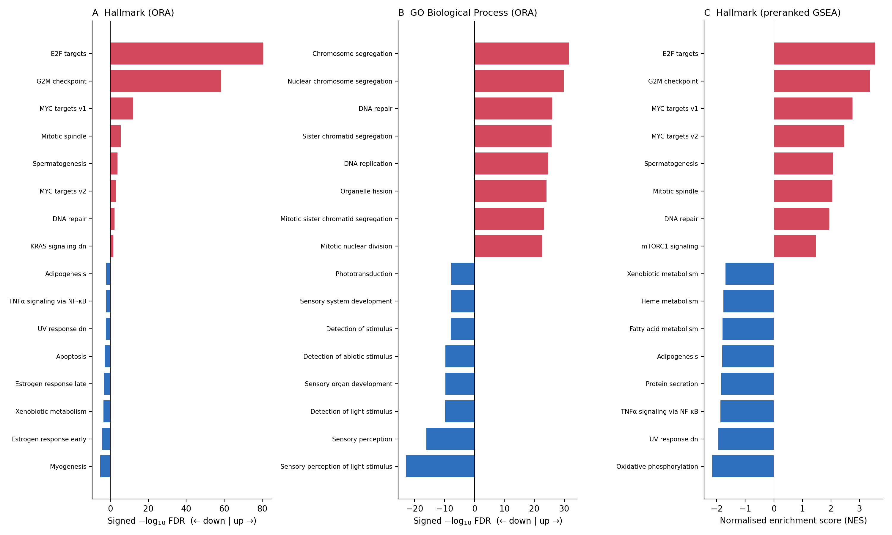

# Retinoblastoma RNA-seq: Differential Expression and Pathway Analysis



Exploration of a DESeq2 differential expression table from retinoblastoma, a childhood eye cancer caused by loss of the *RB1* gene. The analysis asks whether the data show the expected biology: **proliferation programmes up, retinal (photoreceptor) identity down**. They do.

**Contents:** [Key results](#key-results) · [Figures](#figures) · [SQL](#sql) · [Repository structure](#repository-structure) · [Reproducing](#reproducing) · [Limitations](#limitations) · [How this was made](#how-this-was-made)

📄 Full write-up: [`REPORT.pdf`](REPORT.pdf) · 🖼️ LinkedIn slides: [`docs/retinoblastoma_linkedin_carousel.pdf`](docs/retinoblastoma_linkedin_carousel.pdf)

## Key results
| | |
|---|---|
| Genes in input table | 57,773 |
| Genes with a valid adjusted p-value | 19,952 |
| **Upregulated** (padj < 0.05, log2FC ≥ 1) | **2,168** |
| **Downregulated** (padj < 0.05, log2FC ≤ −1) | **1,738** |

- **Up:** E2F targets (FDR 3×10⁻⁸¹), G2M checkpoint, MYC targets, DNA replication and repair. Top genes include *DLL3, CKAP2L, NDC80, KIF20A*.
- **Down:** phototransduction and sensory perception. Photoreceptor genes such as *NRL, GRK1, RHO* and *GNAT1* are lower.
- **Sanity check:** *RB1* down (log2FC −1.68), *MYCN* up (+4.55), *MKI67* and *TOP2A* up, as expected for retinoblastoma.
- **Interpretation:** without RB1, E2F drives the cell cycle, so proliferation genes switch on while specialised retinal genes drop.

## Figures
| Figure | Description |
|---|---|
| [`volcano_plot.png`](figures/volcano_plot.png) | Volcano plot with gene symbols |
| [`enrichment_heatmap.png`](figures/enrichment_heatmap.png) | Hallmark, KEGG and Reactome enrichment for the up and down gene lists |
| [`enrichment_dotplots.png`](figures/enrichment_dotplots.png) | Top GO Biological Process and Reactome terms |
| [`enrichment_plots.png`](figures/enrichment_plots.png) | Enrichment summary (over-representation and GSEA) |
| [`gsea_running_scores.png`](figures/gsea_running_scores.png) | GSEA running-score curves |
| [`pathway_gene_heatmap.png`](figures/pathway_gene_heatmap.png) | log2FC of the strongest genes in key pathways |
| [`MA_plot.png`](figures/MA_plot.png) | Mean expression versus fold change |
| [`top_genes_and_qc.png`](figures/top_genes_and_qc.png) | Top genes, p-value histogram, gene counts |

**Interactive volcano plot:** [`docs/volcano_interactive.html`](docs/volcano_interactive.html). GitHub shows HTML files as code, so to view it, turn on GitHub Pages (Settings → Pages → Branch `main`, folder `/docs`) and open `https://<your-username>.github.io/<repo-name>/volcano_interactive.html`.



## SQL
Results are loaded into a SQLite database ([`data/retinoblastoma.db`](data/retinoblastoma.db)) with four tables: `genes`, `enrichment_ora`, `enrichment_gsea`, `hallmark_membership`. Seven queries ([`sql/analysis_queries.sql`](sql/analysis_queries.sql)) use joins, CTEs, window functions, aggregation with `HAVING`, and `CASE` binning. Their outputs are in [`sql/query_results.md`](sql/query_results.md).

Example: which Hallmark pathways have the highest mean fold change?
```sql
SELECT m.pathway,
       COUNT(*)                AS genes_tested,
       SUM(g.status = 'Up')    AS n_up,
       ROUND(AVG(g.log2fc), 2) AS mean_log2fc
FROM hallmark_membership m
JOIN genes g ON g.symbol = m.symbol
GROUP BY m.pathway
HAVING COUNT(*) >= 30
ORDER BY mean_log2fc DESC
LIMIT 5;
```
| pathway | genes_tested | n_up | mean_log2fc |
|---|---|---|---|
| HALLMARK_E2F_TARGETS | 198 | 135 | 1.99 |
| HALLMARK_G2M_CHECKPOINT | 198 | 116 | 1.77 |
| HALLMARK_MYC_TARGETS_V2 | 56 | 16 | 0.94 |
| HALLMARK_MYC_TARGETS_V1 | 199 | 60 | 0.80 |
| HALLMARK_SPERMATOGENESIS | 101 | 26 | 0.73 |

**To run the queries without coding:** install the free [DB Browser for SQLite](https://sqlitebrowser.org/), open `data/retinoblastoma.db`, go to *Execute SQL*, and paste a query from `sql/analysis_queries.sql`.

## Methods
| Step | Detail |
|---|---|
| Filtering | Genes with a valid adjusted p-value (zero-count, outlier and low-expression genes are removed by DESeq2) |
| Significance | padj < 0.05 and \|log2FC\| ≥ 1 |
| Annotation | Ensembl ID to gene symbol via the MSigDB v7.5.1 mapping (89% of tested genes mapped) |
| Over-representation | One-sided hypergeometric test on the up and down lists separately, background = tested genes, gene sets of 10 to 500 genes, Benjamini-Hochberg FDR |
| GSEA | Preranked on the Wald statistic, 1,000 permutations, `gseapy` |
| Gene sets | MSigDB Hallmark, KEGG, Reactome, GO Biological Process |

## Repository structure
```
├── README.md
├── REPORT.pdf                full written report
├── data/
│   ├── retinoblastoma_gene_results.csv   input DESeq2 table
│   ├── annotated_results_all_genes.csv   input + gene symbols + category
│   ├── significant_DEGs_annotated.csv    3,906 significant genes
│   ├── enrichment_ORA.csv, enrichment_GSEA.csv
│   ├── top15_up.csv, top15_down.csv
│   └── retinoblastoma.db                 SQLite database
├── figures/                  all figures (PNG/PDF)
├── sql/                      queries and their outputs
├── scripts/                  analysis code (see scripts/README.md)
└── docs/                     interactive plot and LinkedIn slides
```

## Reproducing
```bash
pip install -r requirements.txt
python scripts/reproduce_volcano.py     # re-creates the volcano plot from the input table
```
The other scripts are included for transparency. They were run in a different environment, and the enrichment scripts need the MSigDB gene-set tables, which are not redistributed here. See [`scripts/README.md`](scripts/README.md).

## Limitations
- **Cell composition:** the photoreceptor drop may partly reflect normal retina being rich in photoreceptors, not only tumour-intrinsic changes.
- **Contrast direction** is not stored in the input file. Positive log2FC is assumed to mean higher in retinoblastoma.
- **Annotation:** 11% of tested genes had no symbol and were left out of enrichment.
- **Noisy fold changes:** log2FC for low-count genes is noisy (median lfcSE about 0.6). Applying `lfcShrink` would help before ranking by effect size.
- **No sample-level plots (PCA, sample heatmap):** the count matrix was not available. `scripts/pca_heatmap_template.py` is ready for one.
- This is a **re-analysis that recovers known biology**, not a new discovery.

## How this was made
The Python analysis scripts and SQL queries were generated with AI assistance (Claude, Anthropic). The project owner framed the question, supplied the DESeq2 results table, reviewed the outputs, checked them against known retinoblastoma biology and wrote the interpretation. The differential expression statistics (DESeq2) were produced before this repository. Please re-run and verify the code before reusing it.

## Data and tools
- Input: DESeq2 results table for retinoblastoma (`data/`). Source and sharing permission: **add the dataset source here before making the repository public.**
- Tools: Python (pandas, SciPy, matplotlib, seaborn, Plotly, gseapy), SQLite, MSigDB v7.5.1 (Liberzon et al.).

## License
Code: MIT (see `LICENSE`). Check the original data's licence before reuse.
